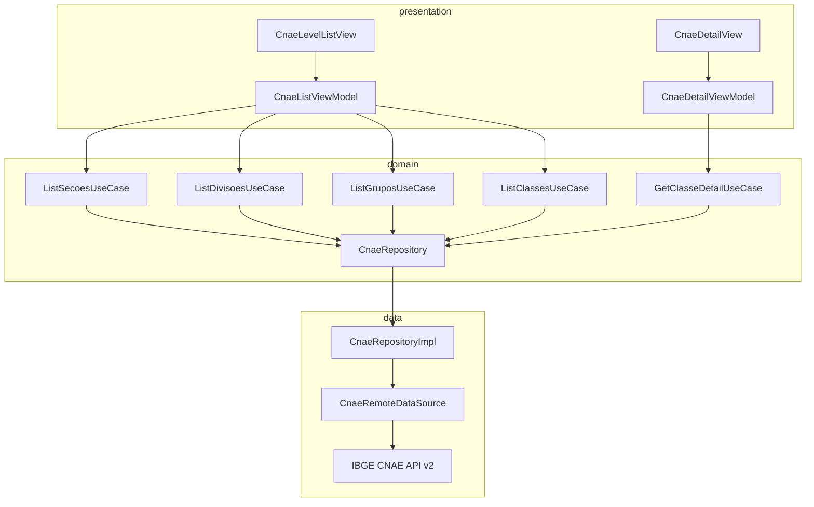

# IBGE CNAE

Flutter client for browsing the Brazilian CNAE (Classificação Nacional de Atividades Econômicas) through the IBGE open data API.

Supports hierarchical navigation from sections to divisions, groups, classes, and class detail with observations.

Domain use cases validate identifiers and delegate to the repository; the data layer maps API payloads and propagates `ResultPattern` outcomes.

Presentation uses view models built on a lightweight `StateManagement` (`ChangeNotifier`) with `StatePattern` for loading, success, and error UI states.

Settings persist dark theme in `shared_preferences`; the root `MaterialApp` listens to `SettingViewModel` via `get_it` and `StateBuilderWidget` (no Provider package).

Includes layered tests (models, data sources, repositories, use cases, view models) and CI with analyze and coverage.

## Structure



## Stack

| Technology | Version |
|------------|---------|
| Dart SDK | ^3.14.0 |
| material_ui | ^1.11.0 |
| connectivity_plus | ^7.1.1 |
| cupertino_icons | ^2.0.0 |
| dio | ^5.11.1 |
| get_it | ^9.3.0 |
| go_router | ^18.0.2 |
| shared_preferences | ^2.5.6 |
| url_launcher | ^6.3.3 |
| flutter_lints | ^6.0.0 |
| build_runner | ^2.16.2 |
| mockito | ^5.8.1 |
| Gradle | 9.5.0 |
| Android Gradle Plugin | 9.3.1 |
| Kotlin | 2.4.20 |
| NDK | 30.0.16248370 |
| compileSdk / targetSdk | 36 |
| minSdk | 29 |
| JVM | 25 |
| iOS Deployment Target | 15.0 |
| Swift | 5.0 |
| GitHub Actions | CI/CD |

## Architecture

```
lib/
    ├── main.dart
    └── src/
        ├── common/
        │   ├── constants/
        │   ├── dependency_injectors/
        │   ├── design/
        │   ├── patterns/
        │   ├── routes/
        │   └── services/
        └── features/
            ├── cnae/
            │   ├── data/
            │   ├── domain/
            │   └── presentation/
            └── settings/
                ├── data/
                ├── domain/
                └── presentation/
```

## API

Base URL: `https://servicodados.ibge.gov.br/api/v2/cnae`

| Step | Endpoint |
|------|----------|
| Seções | `GET /secoes` |
| Divisões | `GET /secoes/{id}/divisoes` |
| Grupos | `GET /divisoes/{id}/grupos` |
| Classes | `GET /grupos/{id}/classes` |
| Detalhe | `GET /classes/{id}` |

## Coverage

dart run build_runner build

flutter test --coverage

genhtml coverage/lcov.info -o coverage/html

open coverage/html/index.html

## ScreenShots

Screenshots can be added under `assets/screenshots/` after capturing the app flow.

## Commits

```
git add . && git commit -m ":rocket: Initial commit." && git push
git add . && git commit -m ":building_construction: Added initial project architecture." && git push
git add . && git commit -m ":memo: Updated project documentation." && git push
git add . && git commit -m ":white_check_mark: Added feature xyz." && git push
git add . && git commit -m ":construction_worker: Added CI build system." && git push
```

## Author

William Franco (Dev mobile).

## License

MIT License

Copyright (c) 2026 William Franco

Permission is hereby granted, free of charge, to any person obtaining a copy
of this software and associated documentation files (the "Software"), to deal
in the Software without restriction, including without limitation the rights
to use, copy, modify, merge, publish, distribute, sublicense, and/or sell
copies of the Software, and to permit persons to whom the Software is
furnished to do so, subject to the following conditions:

The above copyright notice and this permission notice shall be included in all
copies or substantial portions of the Software.

THE SOFTWARE IS PROVIDED "AS IS", WITHOUT WARRANTY OF ANY KIND, EXPRESS OR
IMPLIED, INCLUDING BUT NOT LIMITED TO THE WARRANTIES OF MERCHANTABILITY,
FITNESS FOR A PARTICULAR PURPOSE AND NONINFRINGEMENT. IN NO EVENT SHALL THE
AUTHORS OR COPYRIGHT HOLDERS BE LIABLE FOR ANY CLAIM, DAMAGES OR OTHER
LIABILITY, WHETHER IN AN ACTION OF CONTRACT, TORT OR OTHERWISE, ARISING FROM,
OUT OF OR IN CONNECTION WITH THE SOFTWARE OR THE USE OR OTHER DEALINGS IN THE
SOFTWARE.